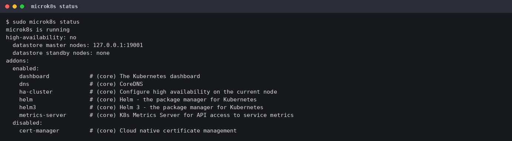
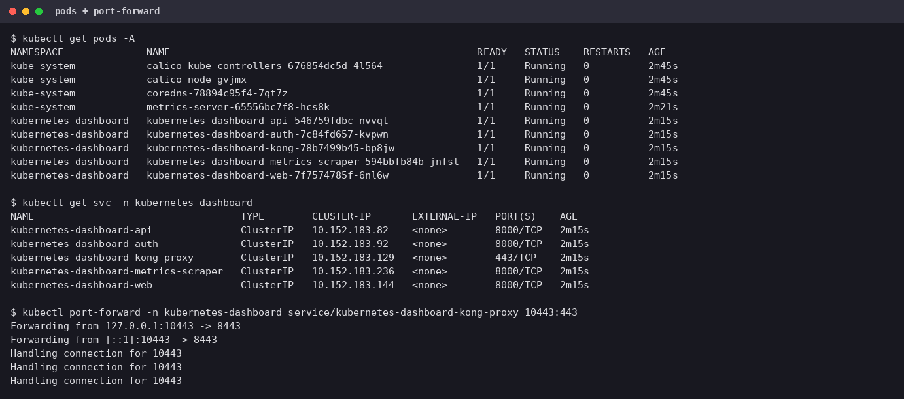
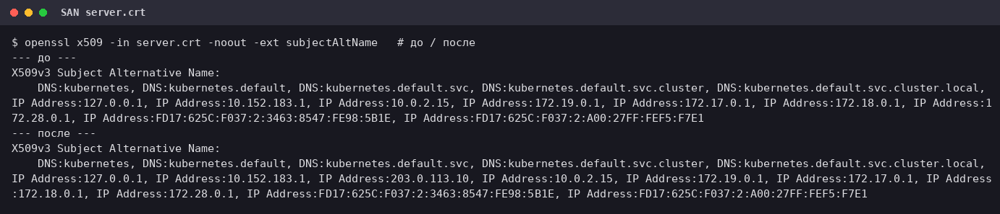
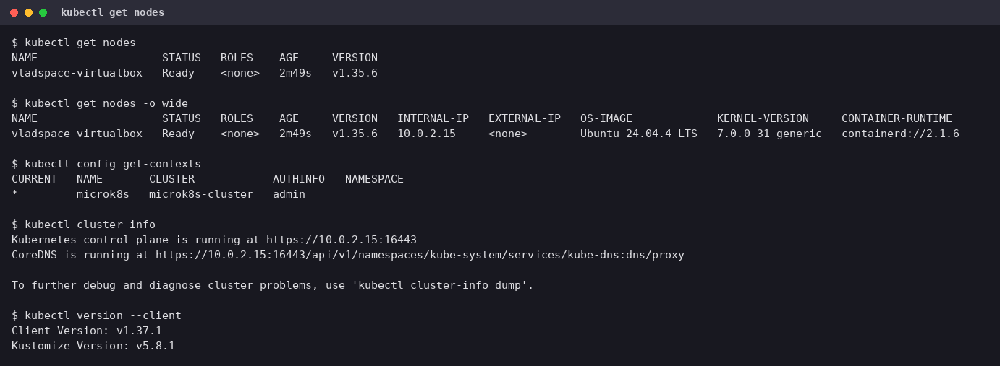

# Домашнее задание к занятию «Kubernetes. Причины появления. Команда kubectl»

Стенд: Oracle VirtualBox VM (Ubuntu 24.04.4 LTS, 4 vCPU, 8 ГБ RAM), MicroK8s **v1.35.6** (snap, канал `1.35/stable`),
локальный `kubectl` **v1.37.1**.

## Задание 1. Установка MicroK8S

### 1.1. Установка

```bash
sudo apt update && sudo apt install snapd      # snapd 2.77.1 уже был в системе
sudo snap install microk8s --classic
sudo usermod -a -G microk8s $USER
mkdir -p ~/.kube && sudo chown -f -R $USER ~/.kube
sudo microk8s status --wait-ready
```



### 1.2. Dashboard

```bash
sudo microk8s enable dashboard
kubectl wait --for=condition=Ready pod --all -A --timeout=300s
```

В MicroK8s 1.35 dashboard — это Kubernetes Dashboard v7 из пяти компонентов (`api`, `auth`, `web`,
`metrics-scraper`, `kong`-прокси) в namespace **`kubernetes-dashboard`**, а не один под в `kube-system`, как в тексте задания.



### 1.3. Сертификат для подключения к внешнему IP

В `/var/snap/microk8s/current/certs/csr.conf.template` в секцию `[ alt_names ]` добавлен адрес (строка `IP.3`
перед маркером `#MOREIPS`), затем сертификаты выпущены заново:

```bash
sudo sed -i 's/^#MOREIPS/IP.3 = 203.0.113.10\n#MOREIPS/' /var/snap/microk8s/current/certs/csr.conf.template
sudo microk8s refresh-certs --cert front-proxy-client.crt   # команда из задания
sudo microk8s refresh-certs --cert server.crt               # сертификат API-сервера
sudo openssl x509 -in /var/snap/microk8s/current/certs/server.crt -noout -ext subjectAltName
```



Нюансы:

- **`front-proxy-client.crt` — не тот сертификат, который видит клиент.** Его использует агрегация API внутри
  кластера. Адрес в SAN, к которому подключается `kubectl`, проверяется по **`server.crt`** (сертификат kube-apiserver),
  поэтому перевыпускал оба.
- `10.0.2.15` (адрес NAT-интерфейса VM) MicroK8s добавляет в SAN сам при установке: по списку «до» он уже есть
  (`logs/san-before.txt`). Чтобы изменение было видно, использован заведомо новый адрес `203.0.113.10` из
  документационного диапазона TEST-NET-3 (RFC 5737). Это **демонстрационный** адрес: у VM за NAT реального внешнего IP нет.
  На облачной ВМ тут стоял бы её публичный IP.
- После `refresh-certs` перезапускаются `kubelite` и `cluster-agent`; пока они поднимаются, dashboard
  кратковременно отвечает 500 (Kong не может разрешить DNS) — через несколько секунд всё приходит в норму.

## Задание 2. Установка и настройка локального kubectl

### 2.1. Установка kubectl

Ссылка из задания (`storage.googleapis.com/kubernetes-release/...`) устарела — проект перенесён на `dl.k8s.io`.
Бинарник скачан оттуда и проверен по контрольной сумме:

```bash
V=$(curl -sL https://dl.k8s.io/release/stable.txt)
curl -sLO "https://dl.k8s.io/release/$V/bin/linux/amd64/kubectl"
curl -sLO "https://dl.k8s.io/release/$V/bin/linux/amd64/kubectl.sha256"
echo "$(cat kubectl.sha256)  kubectl" | sha256sum --check      # kubectl: OK
chmod +x kubectl && sudo mv kubectl /usr/local/bin/kubectl
source <(kubectl completion bash)
echo 'source <(kubectl completion bash)' >> ~/.bashrc
```

### 2.2. Подключение к кластеру

```bash
sudo microk8s config > ~/.kube/config && chmod 600 ~/.kube/config
kubectl get nodes
```



В kubeconfig `server: https://10.0.2.15:16443` — подключение идёт по адресу, который есть в SAN сертификата.

### 2.3. Dashboard через port-forward

```bash
kubectl port-forward -n kubernetes-dashboard service/kubernetes-dashboard-kong-proxy 10443:443
# токен для входа:
kubectl -n kube-system get secret microk8s-dashboard-token -o jsonpath='{.data.token}' | base64 -d
```

Dashboard открывается на <https://127.0.0.1:10443> (сертификат самоподписанный, браузер ругнётся).
Команда из задания (`-n kube-system service/kubernetes-dashboard 10443:443`) в 1.35 не работает: такого сервиса
в `kube-system` больше нет, входная точка — `kubernetes-dashboard-kong-proxy`.

DASHBOARD_PLACEHOLDER

## Что не совпало с текстом задания

| В задании | На практике |
|---|---|
| `service/kubernetes-dashboard` в `kube-system` | `service/kubernetes-dashboard-kong-proxy` в `kubernetes-dashboard` |
| `refresh-certs --cert front-proxy-client.crt` | нужен ещё `server.crt` — именно он предъявляется клиентам |
| `storage.googleapis.com/kubernetes-release` | `dl.k8s.io` + проверка sha256 |
| `usermod -a -G microk8s` | группа применяется после нового логина (`newgrp microk8s`); в сессии без неё использован `sudo` |
